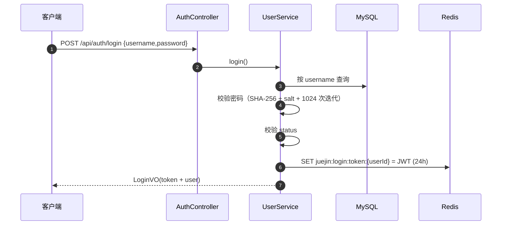
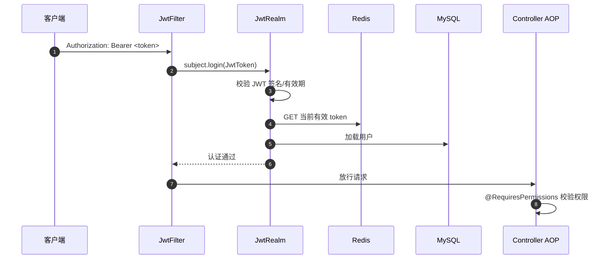

# 基础认证与权限设计

> 状态：已实现并完成联调验证
> 日期：2026-10-17
> 关联代码：`com.juejin.security`、`com.juejin.config.ShiroConfig`

## 1. 背景与目标

为项目提供统一的认证、授权基础设施，满足：

- 用户名 + 密码登录；
- 手机号验证码登录（见 [手机号验证码登录方案](./sms-login-design.md)）；
- 基于 JWT 的无状态认证；
- 基于 Shiro 的角色/权限校验；
- 支持主动退出、改密/禁用后旧 token 立即失效；
- 不依赖 Shiro Session，方便多实例部署。

## 2. 技术选型

| 组件 | 用途 |
| --- | --- |
| Spring Boot 3.5 | Web 基础 |
| Apache Shiro 2.2.1（jakarta classifier） | 认证、授权、注解鉴权 |
| JWT（JJWT 0.12.6） | 无状态令牌 |
| Redis | token 存储与失效控制 |
| MyBatis-Plus | 用户数据访问 |

### 为什么 token 还要存 Redis

JWT 本身无状态，但无法主动失效。Redis 中保存当前有效 token 后：

- 退出登录可立即删除；
- 修改密码、禁用账号可立即让旧 token 失效；
- 不允许同一账号多端同时登录（新 token 覆盖旧 token）。

代价是每次请求多一次 Redis 读取，但换来了可控的会话生命周期。

## 3. 认证流程

### 3.1 用户名密码登录



### 3.2 每次请求的认证



关键实现：

- [`JwtFilter`](../src/main/java/com/juejin/security/JwtFilter.java)：从 `Authorization` / `X-Token` 取 token；
- [`JwtRealm`](../src/main/java/com/juejin/security/JwtRealm.java)：JWT 校验 + Redis 比对 + 用户加载 + 授权信息；
- [`StatelessSubjectFactory`](../src/main/java/com/juejin/security/StatelessSubjectFactory.java)：关闭 Shiro Session 创建。

## 4. Shiro 配置

### 4.1 过滤器链

| 路径 | 过滤器 | 说明 |
| --- | --- | --- |
| `/api/auth/login` | `anon` | 用户名密码登录 |
| `/api/auth/register` | `anon` | 用户名密码注册 |
| `/api/auth/sms/**` | `anon` | 短信验证码发送/登录 |
| `/api/**` | `jwt` | 其余接口必须携带有效 token |
| `/**` | `anon` | 非 API 路径 |

### 4.2 权限模型

当前为角色映射的简化模型，定义在 `JwtRealm#doGetAuthorizationInfo`：

| 角色 | 权限 |
| --- | --- |
| `admin` | `*`（全部接口） |
| `user` | `user:read` |

接口通过注解声明所需权限，例如：

```java
@RequiresPermissions("user:list")
@GetMapping
public Result<PageResult<UserVO>> page(...) { ... }
```

未登录 → `401`，无权限 → `403`，由 [`GlobalExceptionHandler`](../src/main/java/com/juejin/common/GlobalExceptionHandler.java) 统一转成 JSON。

### 4.3 AOP 鉴权

`ShiroConfig` 中注册：

- `AuthorizationAttributeSourceAdvisor`：识别 Shiro 注解；
- `DefaultAdvisorAutoProxyCreator`：为 Controller 创建代理。

## 5. 数据模型

`sys_user`：

| 字段 | 说明 |
| --- | --- |
| `id` | 主键 |
| `username` | 用户名，唯一 |
| `phone` | 手机号，唯一、可空 |
| `password` / `salt` | 密码哈希与盐；手机号用户为空 |
| `nickname` | 昵称 |
| `role` | `admin` / `user` |
| `status` | 1 启用，0 禁用 |
| `deleted` | 逻辑删除 |
| `create_time` / `update_time` | 时间戳 |

## 6. 接口

| 方法 | 路径 | 权限 | 说明 |
| --- | --- | --- | --- |
| POST | `/api/auth/register` | 匿名 | 用户名密码注册 |
| POST | `/api/auth/login` | 匿名 | 用户名密码登录 |
| POST | `/api/auth/logout` | 登录 | 退出登录 |
| GET | `/api/auth/me` | 登录 | 当前用户 |
| POST | `/api/auth/sms/send` | 匿名 | 发送验证码 |
| POST | `/api/auth/sms/login` | 匿名 | 手机号验证码登录 |
| GET | `/api/users` | `user:list` | 用户分页 |
| GET | `/api/users/{id}` | `user:read` | 用户详情 |
| POST | `/api/users` | `user:add` | 新增用户 |
| PUT | `/api/users/{id}` | `user:update` | 修改用户 |
| DELETE | `/api/users/{id}` | `user:delete` | 逻辑删除用户 |

## 7. Redis Key

| Key | 内容 | TTL |
| --- | --- | --- |
| `juejin:login:token:{userId}` | 当前有效 JWT | 24 小时 |

短信相关 key 见 [手机号验证码登录方案](./sms-login-design.md#5-redis-设计)。

## 8. 安全设计

| 风险 | 处理 |
| --- | --- |
| 密码泄漏 | SHA-256 + 随机盐 + 1024 次迭代；接口与日志不返回密码/盐 |
| Token 伪造 | JWT HMAC 签名，密钥至少 32 字节 |
| Token 主动失效 | Redis 保存当前 token，退出/改密/禁用时删除 |
| 越权 | Shiro `@RequiresPermissions` + 统一 403 |
| 无 token 访问 | JwtFilter 统一返回 401 JSON |
| CORS | 开发环境放开，生产需收紧 |
| 会话固定 | 禁用 Shiro Session，完全使用 token |

## 9. 配置

```yaml
app:
  jwt:
    secret: ${JWT_SECRET:...}   # 至少 32 字节，生产必须替换
    expire-seconds: 86400
```

## 10. 测试结果

- 无 token 访问受保护接口 → 401；
- 管理员登录、分页查询 → 通过；
- 普通用户访问用户列表 → 403，访问详情 → 200；
- 退出登录后旧 token → 401；
- 修改密码后旧 token → 401；
- 伪造 token → 401；
- 逻辑删除用户后查询 → 404；
- 手机号验证码登录 → 复用同一套 token 机制，通过。

## 11. 已知限制与后续优化

- 角色权限目前硬编码，生产可扩展 `sys_role` / `sys_permission` / `sys_user_role` 表；
- 密码哈希可升级为 BCrypt/Argon2；
- 单端登录策略如有需要可改为多端并存（Redis 存 token 集合）；
- 可增加刷新 token、记住我、登录审计等能力；
- 生产环境需收紧 CORS，并将密钥放入配置中心或环境变量。

## 12. 变更记录

| 日期 | 变更 |
| --- | --- |
| 2026-10-17 | 初始认证与权限方案 |
