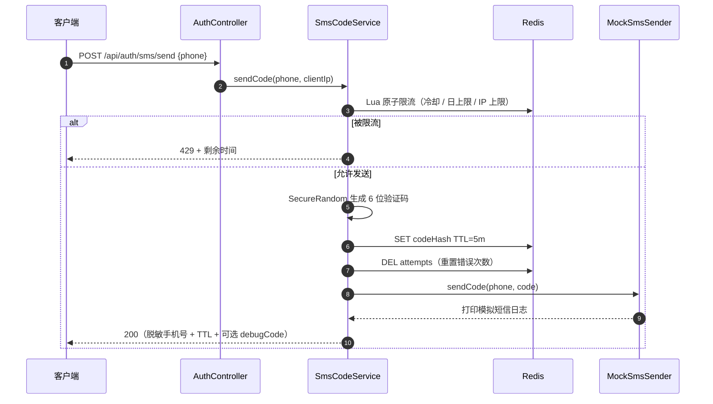
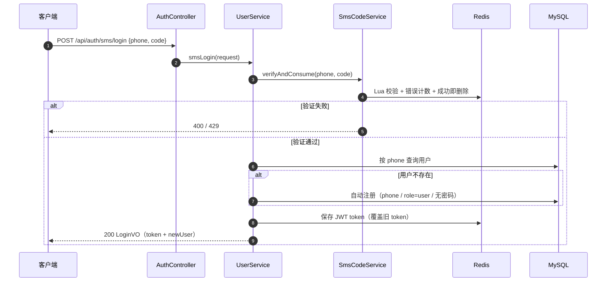

# 手机号验证码登录方案

> 状态：已实现并完成联调验证
> 日期：2026-10-17
> 关联代码：`com.juejin.sms`、`AuthController`、`UserServiceImpl`

## 1. 背景与目标

项目已有「用户名 + 密码」登录。本次新增「手机号 + 短信验证码」登录/注册能力：

- 用户输入手机号，获取 6 位验证码；
- 输入验证码后一键登录；
- 手机号未注册时自动注册，用户无需单独走注册流程；
- 当前没有第三方短信平台，需要**模拟发送**；
- 模拟实现不能是玩具代码，整体流程要满足生产环境要求；
- 复用已有的 JWT + Shiro + Redis 认证体系。

### 非目标

- 不接入具体短信厂商（只预留可替换接口）；
- 不做图形验证码、设备指纹、风控评分；
- 不做账号合并、手机号换绑、多设备登录策略调整。

## 2. 方案概览

```text
客户端
  │
  ├─ POST /api/auth/sms/send   (anon)
  │      └─ AuthController → SmsCodeService
  │             ├─ Redis Lua：冷却/日上限/IP 上限
  │             ├─ SecureRandom 生成验证码
  │             ├─ Redis：保存验证码哈希（5 分钟）
  │             └─ SmsSender（MockSmsSender / 真实厂商实现）
  │
  └─ POST /api/auth/sms/login  (anon)
         └─ AuthController → UserService.smsLogin
                ├─ SmsCodeService：Lua 原子校验 + 一次性消费
                ├─ MySQL：按手机号查询，不存在则自动注册
                ├─ JwtUtil：签发 JWT
                └─ Redis：保存登录 token
```

### 关键决策

| 决策 | 原因 |
| --- | --- |
| 登录接口自动注册 | 验证码已经证明手机号归属，减少一次跳转，注册/登录体验统一 |
| 验证码存哈希而非明文 | 降低 Redis 数据泄漏时的风险 |
| 校验与删除用 Lua 原子完成 | 防止并发请求重复使用同一验证码 |
| 发送限流也用 Lua | 冷却、每日、IP 三个限制必须原子判断 |
| 抽象 `SmsSender` 接口 | 模拟实现与真实短信平台可无缝切换 |
| `debugCode` 双重开关 | 本地可联调，生产默认不可能返回验证码 |
| 手机号用户无密码 | 手机号账号的登录凭证就是短信验证码，避免伪造密码 |

## 3. 数据模型

### 3.1 `sys_user` 变更

| 字段 | 变更 | 说明 |
| --- | --- | --- |
| `phone` | 新增，`VARCHAR(20)`，唯一索引 `uk_phone` | 手机号，可为空（原有账号） |
| `password` | 改为可空 | 手机号注册用户没有密码 |
| `salt` | 改为可空 | 同上 |
| `username` | 保持非空唯一 | 手机号用户默认使用手机号；冲突时使用 `u{phone}_{随机后缀}` |

### 3.2 迁移

- 新数据库：直接执行 [`sql/schema.sql`](../sql/schema.sql)。
- 已有数据库：执行一次 [`sql/migration/2026-10-17-add-phone.sql`](../sql/migration/2026-10-17-add-phone.sql)。

```bash
mysql -uroot -p < sql/migration/2026-10-17-add-phone.sql
```

### 3.3 删除与重新注册

逻辑删除时同时：

- 将 `phone` 置为 `NULL`；
- 将 `username` 重命名为 `del_{id}_{random}`。

这样不会因为逻辑删除行的唯一索引占位，导致同一手机号无法重新注册。

## 4. 接口设计

两个接口都在 Shiro 的匿名白名单中：`/api/auth/sms/** = anon`。

### 4.1 发送验证码

```http
POST /api/auth/sms/send
Content-Type: application/json
```

请求：

```json
{
  "phone": "13800138000"
}
```

响应（mock 模式）：

```json
{
  "code": 200,
  "message": "验证码已发送",
  "data": {
    "phone": "138****8000",
    "expiresIn": 300,
    "retryAfter": 60,
    "debugCode": "691684"
  }
}
```

说明：

- `phone` 返回脱敏值；
- `expiresIn`：验证码有效期（秒）；
- `retryAfter`：下次允许发送的间隔（秒）；
- `debugCode`：仅 `app.sms.mock=true` 且 `app.sms.expose-code=true` 时存在。

错误：

| HTTP | 场景 |
| --- | --- |
| 400 | 手机号格式错误 |
| 429 | 60 秒冷却中 / 当日手机号上限 / IP 小时上限 |
| 500 | 短信发送器调用失败 |

### 4.2 手机号 + 验证码登录

```http
POST /api/auth/sms/login
Content-Type: application/json
```

请求：

```json
{
  "phone": "13800138000",
  "code": "691684"
}
```

响应：

```json
{
  "code": 200,
  "message": "登录成功",
  "data": {
    "token": "eyJhbGciOi...",
    "tokenType": "Bearer",
    "expiresIn": 86400,
    "newUser": true,
    "user": {
      "id": 3,
      "username": "13800138000",
      "phone": "13800138000",
      "nickname": "用户8000",
      "role": "user",
      "status": 1
    }
  }
}
```

- `newUser=true`：本次登录自动注册了新账号；
- 后续请求使用 `Authorization: Bearer <token>`。

错误：

| HTTP | 场景 |
| --- | --- |
| 400 | 参数格式错误 / 验证码错误 / 验证码过期 |
| 403 | 账号被禁用 |
| 409 | 自动注册发生唯一键冲突 |
| 429 | 验证码错误次数达到上限 |

## 5. Redis 设计

| Key | 内容 | TTL | 用途 |
| --- | --- | --- | --- |
| `juejin:sms:code:{phone}` | 验证码哈希 | 5 分钟 | 验证码校验 |
| `juejin:sms:attempts:{phone}` | 错误次数 | 5 分钟 | 限制暴力尝试 |
| `juejin:sms:cooldown:{phone}` | `1` | 60 秒 | 发送冷却 |
| `juejin:sms:daily:{phone}:{yyyyMMdd}` | 次数 | 24 小时 | 手机号每日上限 |
| `juejin:sms:ip:{ip}:{yyyyMMddHH}` | 次数 | 1 小时 | IP 每小时上限 |
| `juejin:login:token:{userId}` | JWT | 24 小时 | 已有登录态（单端登录） |

验证码哈希：

```text
SHA-256 迭代哈希(code, salt = phone + ":" + pepper)
```

`pepper` 来自 `app.sms.pepper`，生产环境必须替换。

## 6. 核心流程

### 6.1 发送验证码



发送失败时释放冷却 key，允许用户立即重试；每日/IP 计数保留。

### 6.2 登录 / 自动注册



### 6.3 校验 Lua 的返回值

| 返回值 | 含义 | 接口响应 |
| --- | --- | --- |
| `1` | 校验通过并已删除验证码 | 继续登录 |
| `0` | 验证码错误，错误次数 +1 | 400 验证码错误 |
| `-1` | 错误次数超限 | 429，验证码作废 |
| `-2` | 验证码不存在或已过期 | 400，提示重新获取 |

## 7. 生产级设计

| 防护点 | 实现 |
| --- | --- |
| 发送冷却 | 同手机号 60 秒 |
| 手机号日上限 | 10 条/天 |
| IP 小时上限 | 30 条/小时 |
| 验证码有效期 | 5 分钟 |
| 错误次数 | 最多 5 次 |
| 防重放 | 校验成功立即删除，Lua 原子消费 |
| 防并发重复使用 | 校验与删除在同一个 Lua 脚本中 |
| 防泄漏 | Redis 存哈希，日志手机号脱敏 |
| 防枚举 | 发送接口不区分是否已注册 |
| 默认安全 | 只有 mock + expose-code 同时为 true 才返回验证码 |
| 并发注册 | 手机号唯一索引 + `DuplicateKeyException` 兜底 |
| 禁用账号 | 验证通过后仍检查 `status`，禁用用户返回 403 |
| 真实短信保护 | `mock=false` 且无真实 `SmsSender` Bean 时应用启动失败 |

### 上线检查清单

- [ ] `SMS_MOCK=false`
- [ ] `SMS_EXPOSE_CODE=false`
- [ ] 替换 `SMS_PEPPER`
- [ ] 接入真实短信平台并配置超时/重试/告警
- [ ] 反向代理后开启 `server.forward-headers-strategy: native`，确保 IP 限流拿到真实客户端 IP
- [ ] 数据库执行手机号迁移脚本
- [ ] 评估是否需要图形验证码/设备风控

## 8. 代码地图

| 文件 | 职责 |
| --- | --- |
| [`AuthController.java`](../src/main/java/com/juejin/controller/AuthController.java) | `/api/auth/sms/send`、`/api/auth/sms/login` |
| [`SmsCodeService.java`](../src/main/java/com/juejin/sms/SmsCodeService.java) | 生成、发送、限流、校验、消费 |
| [`SmsSender.java`](../src/main/java/com/juejin/sms/SmsSender.java) | 短信发送抽象 |
| [`MockSmsSender.java`](../src/main/java/com/juejin/sms/MockSmsSender.java) | 模拟发送器（日志输出） |
| [`SmsProperties.java`](../src/main/java/com/juejin/sms/SmsProperties.java) | `app.sms.*` 配置 |
| [`sms_send_limit.lua`](../src/main/resources/lua/sms_send_limit.lua) | 发送限流原子脚本 |
| [`sms_verify.lua`](../src/main/resources/lua/sms_verify.lua) | 校验 + 一次性消费原子脚本 |
| [`UserServiceImpl.java`](../src/main/java/com/juejin/service/impl/UserServiceImpl.java) | 手机号登录、自动注册、JWT 签发 |
| [`ShiroConfig.java`](../src/main/java/com/juejin/config/ShiroConfig.java) | 放行 `/api/auth/sms/**` |
| [`application.yml`](../src/main/resources/application.yml) | 短信与限流配置 |

## 9. 配置项

```yaml
app:
  sms:
    mock: ${SMS_MOCK:true}
    expose-code: ${SMS_EXPOSE_CODE:true}
    code-ttl: 5m
    send-interval: 60s
    max-attempts: 5
    daily-limit-per-phone: 10
    hourly-limit-per-ip: 30
    pepper: ${SMS_PEPPER:juejin-sms-pepper-change-me}
```

## 10. 接入真实短信平台

1. 新建实现类：

```java
@Component
@ConditionalOnProperty(prefix = "app.sms", name = "mock", havingValue = "false")
public class AliyunSmsSender implements SmsSender {
    @Override
    public void sendCode(String phone, String code) {
        // 调用短信平台：建议设置连接/读取超时、有限重试、失败告警
    }
}
```

2. 配置：

```yaml
app:
  sms:
    mock: false
    expose-code: false
```

3. 建议在真实实现中补充：
   - 平台模板 ID / 签名 / AccessKey 的配置化管理；
   - 重试与降级（不要无限重试）；
   - 发送量监控和费用告警；
   - 供应商返回码解析与日志脱敏。

## 11. 测试结果（2026-10-17）

| 场景 | 预期 | 实测 |
| --- | --- | --- |
| 发送验证码 | 200，返回脱敏手机号和 debugCode | 通过 |
| 60 秒内重复发送 | 429 | 通过 |
| 错误验证码 | 400，attempts +1 | 通过 |
| 连续错误 5 次 | 第 5 次 429，验证码作废 | 通过 |
| 正确验证码首次登录 | 200，newUser=true，自动注册 | 通过 |
| 验证码重复使用 | 400，已过期 | 通过 |
| 已注册手机号再次登录 | 200，newUser=false | 通过 |
| 每日手机号上限 | 429 | 通过 |
| IP 小时上限 | 429 | 通过 |
| 手机号格式错误 | 400 | 通过 |
| `expose-code=false` | 响应不含 debugCode，仅日志输出 | 通过 |
| 管理员创建带手机号用户 | 成功，返回 phone | 通过 |
| 重复手机号创建 | 400 | 通过 |
| 手机号用户尝试密码登录 | 401 | 通过 |
| 删除后同一手机号重新注册 | newUser=true，重新创建成功 | 通过 |
| 原有 admin 密码登录 | 正常 | 通过 |

## 12. 已知限制与后续优化

- **IP 限流依赖 `remoteAddr`**：部署在代理后需正确配置转发头，否则所有请求会被算作代理 IP。
- **缺少风控**：高风险场景建议叠加图形验证码、设备指纹、行为风控。
- **缺少发送审计**：当前限流数据只在 Redis，建议将发送/验证事件落库，便于审计与费用分析。
- **数据库迁移未使用 Flyway/Liquibase**：当前为手写迁移脚本，长期建议引入版本化迁移工具。
- **手机号换绑/账号合并未实现**：如需要，应增加二次验证和冲突处理流程。
- **单端登录**：与原有用户名密码登录保持一致，新 token 会覆盖旧 token。
- **Mock 验证码会写入日志**：仅限开发环境，上线前必须关闭 mock。

## 13. 变更记录

| 日期 | 变更 |
| --- | --- |
| 2026-10-17 | 新增手机号验证码登录/自动注册、模拟短信、Redis 限流与原子校验 |
